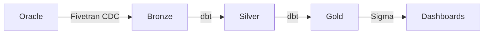

# Migration-Expert Skill — Comprehensive Audit Report

**Audited By:** CoCoDuo Skill Development Advisor  
**Date:** 2026-03-25  
**Skill Version:** 2.0 (inferred from SKILL.md)  
**Scope:** Full audit of `/migration-expert/` — SKILL.md, knowledge base, scripts, brand resources, and companion integrations (Streamlit app, notebook)

---

## Executive Summary

The **migration-expert** skill is a well-structured, domain-rich Cortex Code skill designed to generate tailored Snowflake migration architecture plans from assessment data captured via a Streamlit intake form. It features a strong persona, deep knowledge base, and a clear multi-phase workflow. However, it has **significant opportunities** to improve efficiency, reduce token waste, harden reliability, and unlock more powerful capabilities.

### Overall Scores

| Category | Score | Grade |
|----------|-------|-------|
| **Skill Structure & Metadata** | 7.5 / 10 | B+ |
| **Knowledge Base Quality** | 8.5 / 10 | A- |
| **Workflow & Logic** | 6.5 / 10 | B- |
| **Efficiency & Token Economy** | 5.0 / 10 | C |
| **Error Handling & Resilience** | 4.0 / 10 | D+ |
| **Integration & Ecosystem** | 7.0 / 10 | B |
| **Extensibility & Maintainability** | 6.0 / 10 | B- |
| **Output Quality & Brand** | 8.0 / 10 | A- |
| **OVERALL** | **6.6 / 10** | **B-** |

---

## 1. Skill Structure & Metadata (7.5/10)

### Strengths
- **Clear persona definition** — "CoCo, the Migration Architect" with explicit personality traits (opinionated, data-driven, Snowflake-native-first) gives the LLM strong behavioral grounding.
- **Well-defined trigger patterns** — The description field covers the right keywords (migration, architecture plan, assessment ID, source system migration).
- **Explicit "When NOT to invoke"** section prevents false activations.
- **Brand identity** is well-established with kipi.ai attribution and CoCoDuo branding.

### Issues Found

#### ISSUE 1.1: Missing YAML Frontmatter Schema Fields (Medium)
The SKILL.md uses a freeform markdown header instead of a structured YAML frontmatter block. This reduces machine-parseability for skill discovery and routing.

**Current:**
```markdown
# CoCoDuo — Migration Expert
**Version:** 2.0
```

**Recommended:**
```yaml
---
name: migration-expert
description: "Generate tailored Snowflake migration architecture plans from customer assessment data. Invoke when user mentions: migration plan, architecture plan, assessment ID, source-system-to-Snowflake migration."
version: "2.0"
author: "kipi.ai"
tags: ["migration", "architecture", "snowflake", "etl", "assessment"]
---
```

#### ISSUE 1.2: No Skill Dependencies Declared (Low)
The skill implicitly depends on the Streamlit app and database tables but doesn't declare these dependencies, making it fragile if the ecosystem changes.

#### ISSUE 1.3: No Version Changelog (Low)
No changelog tracking what changed between versions. Important for a v2.0 skill.

---

## 2. Knowledge Base Quality (8.5/10)

### Strengths
- **Exceptional tool-profiles.md** — The most impressive knowledge file. Every tool has ratings (1-10), strengths, weaknesses, pricing, AI/ML capabilities, and "Pick this when" decision criteria. This is production-grade knowledge engineering.
- **Comprehensive source-system-playbooks.md** — Platform-specific migration checklists for Oracle, Teradata, SQL Server, Redshift, BigQuery, and Databricks are thorough and practical.
- **Architecture-patterns.md** covers all major patterns (Medallion, Data Vault 2.0, Star Schema, Data Mesh) with Snowflake-specific implementation guidance.
- **Multi-tenancy-patterns.md** adds a valuable differentiator for enterprise migrations.
- **tool-selection-matrix.md** provides quick-reference comparison tables.

### Issues Found

#### ISSUE 2.1: Knowledge Redundancy Between tool-profiles.md and tool-selection-matrix.md (Medium)
Both files cover tool comparisons but with different depth and structure. This wastes tokens when both are loaded — the LLM reads overlapping content twice.

**Recommendation:** Merge `tool-selection-matrix.md` into `tool-profiles.md` as a quick-reference appendix, or instruct the skill to load only one based on context (matrix for overviews, profiles for deep comparisons).

#### ISSUE 2.2: No Knowledge File for Snowflake Cost Optimization (High)
The skill recommends warehouse sizes and tools with cost implications but has no dedicated knowledge file for Snowflake credit estimation, Resource Monitor setup, or cost modeling. This is a gap given that "cost reduction" is one of the most common migration drivers.

**Recommendation:** Add `knowledge/cost-optimization-patterns.md` covering:
- Credit estimation formulas per warehouse size
- Resource Monitor templates
- Auto-suspend/auto-resume best practices
- Credit monitoring with ACCOUNT_USAGE views
- Cost comparison frameworks (legacy vs. Snowflake)

#### ISSUE 2.3: No Knowledge File for Data Migration Execution (Medium)
The skill generates architecture *plans* but has no playbook for the actual data migration execution (COPY INTO strategies, parallel loading, large table migration, cutover planning, data validation queries).

**Recommendation:** Add `knowledge/data-migration-execution.md` covering:
- Bulk loading strategies (COPY INTO optimization, file sizing, parallel threads)
- Large table migration patterns (chunked loading, time-partitioned extraction)
- Cutover planning templates
- Data validation SQL templates (row counts, checksums, sampling)

#### ISSUE 2.4: Reference PDFs Are Not Parseable by the Skill (Medium)
The `knowledge/references/` directory contains 8 PDF files and 2 SVG images. The SKILL.md instructs CoCo to "reference these when generating plans" but PDFs require explicit reading with tools. The skill doesn't instruct the LLM to read them programmatically.

**Recommendation:** Either:
1. Extract key insights from PDFs into a `knowledge/reference-summaries.md` file (preferred — reduces runtime token cost)
2. Add explicit instructions in SKILL.md to use the Read tool on specific PDFs when relevant

#### ISSUE 2.5: SVG Architecture Diagrams Not Leveraged (Low)
`snowflake_migration_phases.svg` and `snowflake_target_state_architecture.svg` exist but the SKILL.md never references them in output formatting or plan generation.

---

## 3. Workflow & Logic (6.5/10)

### Strengths
- **Clear 5-phase workflow** (Load Assessment → Analyze → Select Tools → Generate Architecture → Render Plan) provides a structured execution path.
- **Decision tree for tool selection** is well-designed with budget sensitivity as the primary filter.
- **Output format** is well-specified with sections, headers, and structure.

### Issues Found

#### ISSUE 3.1: No Fallback When Assessment Data Is Missing (Critical)
The skill assumes assessment data exists in `MIGRATION_ASSESSMENTS.INTAKE.ASSESSMENTS`. If the table doesn't exist, the query fails, or the assessment_id doesn't match, there is **no graceful degradation path**.

**Recommendation:** Add a fallback workflow:
```markdown
## Fallback: No Assessment Data
If assessment data cannot be loaded (table missing, ID not found, or empty):
1. Ask the user to provide key details interactively:
   - Source system(s)
   - Approximate data volume
   - Budget sensitivity
   - Key migration drivers
2. Generate a "lightweight architecture sketch" from these inputs
3. Recommend they complete the full assessment via the Streamlit app for a detailed plan
```

#### ISSUE 3.2: No Iterative Refinement Loop (High)
The workflow is strictly linear (assess → generate). There's no instruction for handling user feedback like "make it more cost-sensitive" or "I don't want Fivetran." The LLM must improvise, which leads to inconsistent behavior.

**Recommendation:** Add a refinement phase:
```markdown
## Phase 6: Iterative Refinement
After presenting the plan, watch for user feedback:
- "Too expensive" → Re-run tool selection with budget_sensitivity bumped one level
- "Don't want [TOOL]" → Exclude tool, re-select from alternatives
- "Add [REQUIREMENT]" → Inject into nuances and regenerate affected sections
- "Compare options" → Generate a focused comparison table for the contested decision
```

#### ISSUE 3.3: Tool Selection Logic Is Prose, Not Structured (Medium)
The tool selection decision tree is described in natural language across multiple knowledge files. This means the LLM must synthesize rules from 3+ files simultaneously, increasing the chance of inconsistency.

**Recommendation:** Create a structured decision matrix in SKILL.md:
```markdown
## Quick Decision Table
| Budget | Team Size | Complexity | → Ingestion | → Transform | → Orchestration |
|--------|-----------|------------|-------------|-------------|-----------------|
| Cost Conscious | <5 | Low | Airbyte/Snowflake Native | dbt-core | Snowflake Tasks |
| Moderate | 5-15 | Medium | Fivetran/Matillion | dbt Cloud | Airflow/Tasks |
| Flexible | 15+ | High | Fivetran + Snowpipe | dbt Cloud + Snowpark | Airflow |
```

#### ISSUE 3.4: No Handling for Multi-Source Migrations (Medium)
The workflow treats the migration as a single unit, but many assessments involve 3-5+ source systems. There's no guidance on:
- Prioritizing which source to migrate first
- Phasing multi-source migrations
- Handling different tools per source system

---

## 4. Efficiency & Token Economy (5.0/10)

### Issues Found

#### ISSUE 4.1: Entire Knowledge Base Loaded Regardless of Context (Critical)
The SKILL.md instructs loading ALL knowledge files for every invocation. For a simple Oracle-to-Snowflake migration, the LLM also loads multi-tenancy patterns, Data Vault details, and 30+ tool profiles that are irrelevant.

**Estimated Token Waste:** ~8,000-15,000 tokens per invocation on irrelevant knowledge.

**Recommendation:** Implement conditional knowledge loading:
```markdown
## Knowledge Loading Strategy
- ALWAYS load: architecture-patterns.md (needed for every plan)
- ALWAYS load: brand-guidelines.md (for output formatting)
- Load source-system-playbooks.md ONLY for sections matching the customer's SOURCE_SYSTEMS
- Load tool-profiles.md ONLY for tool categories relevant to the assessment
- Load multi-tenancy-patterns.md ONLY if customer has multi-tenant requirements
- Load tool-selection-matrix.md ONLY if user asks for tool comparisons (not full plans)
```

#### ISSUE 4.2: SKILL.md Is Too Long (~800+ lines) (High)
The SKILL.md contains detailed output templates, examples, and inline knowledge that should be in separate resource files. Long SKILL.md files consume the context window and push out conversation history.

**Recommendation:** Refactor to:
- `SKILL.md` (~200 lines): Core persona, triggers, workflow steps, knowledge loading rules
- `knowledge/output-templates.md`: All output format templates
- `knowledge/decision-framework.md`: Consolidated tool selection logic

#### ISSUE 4.3: Redundant Tool Information Across Files (Medium)
Tool data appears in 3 places:
1. `tool-profiles.md` (detailed profiles)
2. `tool-selection-matrix.md` (comparison tables)
3. `SKILL.md` (inline recommendations in the workflow)

**Recommendation:** Establish `tool-profiles.md` as the single source of truth. Remove inline tool recommendations from SKILL.md and reference the file instead.

#### ISSUE 4.4: No Caching/Memoization Strategy (Low)
When the same customer assessment is referenced multiple times in a conversation, the skill re-fetches and re-processes the full assessment each time.

**Recommendation:** Add instruction to store assessment data in session state after first fetch.

---

## 5. Error Handling & Resilience (4.0/10)

### Issues Found

#### ISSUE 5.1: No SQL Error Handling (Critical)
The `fetch-assessment.sql` script uses raw string interpolation (`'<ASSESSMENT_ID>'`). If the assessment table doesn't exist or the ID is malformed, the skill has no recovery path.

**Recommendation:** Add pre-flight checks:
```sql
-- Pre-flight: Verify table exists
SELECT COUNT(*) FROM INFORMATION_SCHEMA.TABLES 
WHERE TABLE_CATALOG = 'MIGRATION_ASSESSMENTS' 
  AND TABLE_SCHEMA = 'INTAKE' 
  AND TABLE_NAME = 'ASSESSMENTS';
```

And in SKILL.md:
```markdown
## Error Handling
1. If ASSESSMENTS table doesn't exist → Tell user to run the Streamlit app first to create the schema
2. If ASSESSMENT_ID returns no rows → List available assessments and ask user to pick one
3. If VARIANT columns return NULL → Use defaults and flag missing sections in the plan
4. If query times out → Suggest checking warehouse size and COMPUTE_WH status
```

#### ISSUE 5.2: No Input Validation for Assessment Data (High)
The skill doesn't validate that loaded assessment data is complete or well-formed before generating a plan. A 30% complete assessment will produce a plan with many assumptions — without flagging this to the user.

**Recommendation:** Add a completeness gate:
```markdown
## Pre-Generation Validation
After loading assessment, check COMPLETENESS_PCT:
- >= 80%: Proceed with full plan generation
- 50-79%: Generate plan but prepend a warning: "⚠️ Assessment is {pct}% complete. The following sections used assumptions: [list]"
- < 50%: Do NOT generate a full plan. Instead, list what's missing and recommend completing the assessment first.
```

#### ISSUE 5.3: No Graceful Handling of Unsupported Source Systems (Medium)
If a customer assessment includes a source system not in the playbooks (e.g., MongoDB, Cassandra, SAP HANA), the skill has no guidance on what to do.

**Recommendation:** Add a generic migration playbook for unsupported sources with common patterns (JDBC extraction, file-based export, API-based extraction).

---

## 6. Integration & Ecosystem (7.0/10)

### Strengths
- **Tight Streamlit app integration** — The assessment form captures all data the skill needs.
- **Database schema alignment** — SKILL.md's SQL queries match the Streamlit app's table definitions exactly.
- **Notebook companion** — `Migration_Plan_Generator.ipynb` provides an alternative execution path.

### Issues Found

#### ISSUE 6.1: No Bi-Directional Integration (High)
The skill reads assessment data but never writes back to Snowflake. Generated architecture plans should be stored in `ASSESSMENTS.ARCHITECTURE_PLAN` (the column exists but is never populated).

**Recommendation:** Add a "Save Plan" step:
```markdown
## Phase 6: Persist Architecture Plan
After generating the plan, save it back to the assessment:
```sql
UPDATE MIGRATION_ASSESSMENTS.INTAKE.ASSESSMENTS
SET ARCHITECTURE_PLAN = PARSE_JSON('<plan_json>'),
    ARCHITECTURE_GENERATED_AT = CURRENT_TIMESTAMP()
WHERE ASSESSMENT_ID = '<assessment_id>';
```
```

#### ISSUE 6.2: No Integration with ai_readiness_skill (Medium)
The `ai_readiness_skill` exists in the same workspace and assesses data quality, governance, security, and infrastructure. Migration plans would be significantly enhanced by incorporating AI readiness scores.

**Recommendation:** Add cross-skill integration:
```markdown
## Optional: AI Readiness Integration
If the user has run an AI Readiness Assessment, incorporate scores into the migration plan:
- Data Quality score → Inform data validation strategy depth
- Security score → Inform governance tool recommendations
- Infrastructure score → Inform warehouse sizing recommendations
```

#### ISSUE 6.3: REFERENCE_ARCHITECTURES Table Never Populated (Medium)
The Streamlit app creates `REFERENCE_ARCHITECTURES` but no workflow populates it. This table could power a "similar customer" recommendation engine.

**Recommendation:** After generating a plan, optionally save it as a reference architecture for future customers in the same industry/source-system combination.

---

## 7. Extensibility & Maintainability (6.0/10)

### Issues Found

#### ISSUE 7.1: Hard-Coded Table Names Throughout (Medium)
Table names (`MIGRATION_ASSESSMENTS.INTAKE.ASSESSMENTS`) are hard-coded in SKILL.md, fetch-assessment.sql, and the Streamlit app. Changing the schema requires edits in 3+ locations.

**Recommendation:** Define table names once in SKILL.md and reference them:
```markdown
## Configuration
- DATABASE: MIGRATION_ASSESSMENTS
- SCHEMA: INTAKE  
- ASSESSMENTS_TABLE: ${DATABASE}.${SCHEMA}.ASSESSMENTS
```

#### ISSUE 7.2: No Versioned Knowledge Files (Medium)
Knowledge files have no version headers or last-updated dates. When Snowflake releases new features (e.g., new Cortex functions, new ingestion methods), there's no way to know if knowledge is current.

**Recommendation:** Add headers to each knowledge file:
```markdown
<!-- Last Updated: 2026-03-25 | Snowflake Version: 8.x | Reviewed By: SA Team -->
```

#### ISSUE 7.3: No Testing Strategy (High)
There is no way to validate that the skill produces correct, high-quality output. No test cases, no expected outputs, no regression suite.

**Recommendation:** Create `tests/` directory with:
- `test-cases.md`: 3-5 sample assessment inputs + expected plan characteristics
- `golden-outputs/`: Reference outputs for regression testing
- Validation criteria: "Oracle migration plan MUST mention SnowConvert", "Cost-sensitive plan MUST NOT recommend Fivetran", etc.

---

## 8. Output Quality & Brand (8.0/10)

### Strengths
- **Well-defined output structure** with clear sections (Executive Summary, Architecture Overview, Tool Stack, etc.)
- **Brand guidelines** are thorough with color codes, tone, and attribution requirements
- **Opinionated recommendations** with clear justification — much better than generic "it depends" responses

### Issues Found

#### ISSUE 8.1: No Visual Architecture Diagram Generation (High)
The plan is text-only. Competing migration consultancies deliver visual architecture diagrams. The skill has SVG templates in `brand-resources/` but doesn't use them.

**Recommendation:** Add Mermaid diagram generation to the output:
```markdown
## Architecture Diagram
Generate a Mermaid flowchart showing:
- Source systems → Ingestion tools → Snowflake layers → BI tools
- Include tool names on each edge/node

Example:

```

#### ISSUE 8.2: No Effort Estimation (High)
The plan recommends tools and architecture but doesn't estimate implementation effort. Customers and SAs need this for scoping.

**Recommendation:** Add effort estimation section:
```markdown
## Implementation Effort Estimate
| Phase | Estimated Duration | Team Size | Key Activities |
|-------|-------------------|-----------|---------------|
| Phase 1: Setup | 2-3 weeks | 2 DE | Snowflake account config, RBAC, warehouse setup |
| Phase 2: Ingestion | 4-6 weeks | 2-3 DE | Source extraction, Fivetran setup, historical load |
| Phase 3: Transform | 6-8 weeks | 2-3 AE | dbt models (Bronze→Silver→Gold), testing |
| Phase 4: BI | 3-4 weeks | 1-2 Analyst | Dashboard migration, Sigma/Tableau setup |
| Phase 5: Cutover | 2-3 weeks | Full team | Parallel run, validation, go-live |
```

#### ISSUE 8.3: No Risk Assessment Section in Output (Medium)
The plan captures migration risks in the assessment but doesn't synthesize them into a risk register with mitigations in the output.

---

## Priority Recommendations (Top 10)

| # | Issue | Severity | Effort | Impact |
|---|-------|----------|--------|--------|
| 1 | **Add fallback workflow for missing assessment data** (3.1) | Critical | Medium | Prevents complete failure when data isn't available |
| 2 | **Implement conditional knowledge loading** (4.1) | Critical | Medium | Saves 8K-15K tokens per invocation, faster response |
| 3 | **Add error handling and pre-flight SQL checks** (5.1) | Critical | Low | Prevents silent failures and confusing error messages |
| 4 | **Add assessment completeness gate** (5.2) | High | Low | Prevents generating unreliable plans from sparse data |
| 5 | **Refactor SKILL.md to ~200 lines** (4.2) | High | Medium | Reduces base token cost, improves focus |
| 6 | **Add cost optimization knowledge file** (2.2) | High | Medium | Fills the biggest knowledge gap for migration customers |
| 7 | **Add iterative refinement loop** (3.2) | High | Low | Makes the skill conversational, not just generative |
| 8 | **Write generated plans back to Snowflake** (6.1) | High | Low | Completes the data lifecycle, enables plan tracking |
| 9 | **Add effort estimation to output** (8.2) | High | Medium | Huge value-add for SA scoping and customer conversations |
| 10 | **Add Mermaid architecture diagrams** (8.1) | High | Low | Visual output dramatically improves plan quality |

---

## Quick Wins (Implement Today)

1. **Add YAML frontmatter** to SKILL.md (5 minutes)
2. **Add error handling instructions** for SQL failures (15 minutes)
3. **Add completeness gate** (10 minutes)
4. **Add iterative refinement instructions** (15 minutes)
5. **Add a `## Save Plan` phase** to write ARCHITECTURE_PLAN back (10 minutes)
6. **Add version headers** to all knowledge files (10 minutes)

---

## Comparison with ai_readiness_skill (Benchmark)

| Aspect | migration-expert | ai_readiness_skill | Winner |
|--------|-----------------|-------------------|--------|
| Structured scoring framework | ❌ No | ✅ 8 dimensions, weighted | ai_readiness |
| SQL probe automation | ❌ Manual fetch | ✅ Automated SQL probes | ai_readiness |
| Resource organization | ✅ Good (knowledge/) | ✅ Excellent (resources/scoring/ + action_plans/) | ai_readiness |
| Persona definition | ✅ Strong | ✅ Strong | Tie |
| Output format specification | ✅ Detailed | ✅ Detailed | Tie |
| Error handling | ❌ None | ⚠️ Basic | ai_readiness |
| Python tooling | ❌ None | ✅ scoring_engine.py, orchestrator.py | ai_readiness |
| Knowledge depth | ✅ Exceptional (6 files, 486 lines tool-profiles) | ✅ Good (16 files across scoring/actions) | migration-expert |
| Extensibility | ⚠️ All in markdown | ✅ Python + markdown + SQL | ai_readiness |

**Key Takeaway:** The migration-expert skill should adopt the ai_readiness_skill's pattern of:
1. Structured scoring/decision files in subdirectories
2. Python helper scripts for complex logic
3. Automated SQL probes instead of manual queries

---

## Conclusion

The migration-expert skill has **best-in-class knowledge content** — the tool profiles, source system playbooks, and architecture patterns are genuinely impressive. The primary weaknesses are in **efficiency** (token waste from loading everything), **resilience** (no error handling), and **workflow completeness** (no refinement loop, no plan persistence, no effort estimation). Implementing the top 10 recommendations would move this skill from a **B- (6.6/10)** to an estimated **A- (8.5/10)**.

---

*Report generated by CoCoDuo Skill Development Advisor · 2026-03-25*
